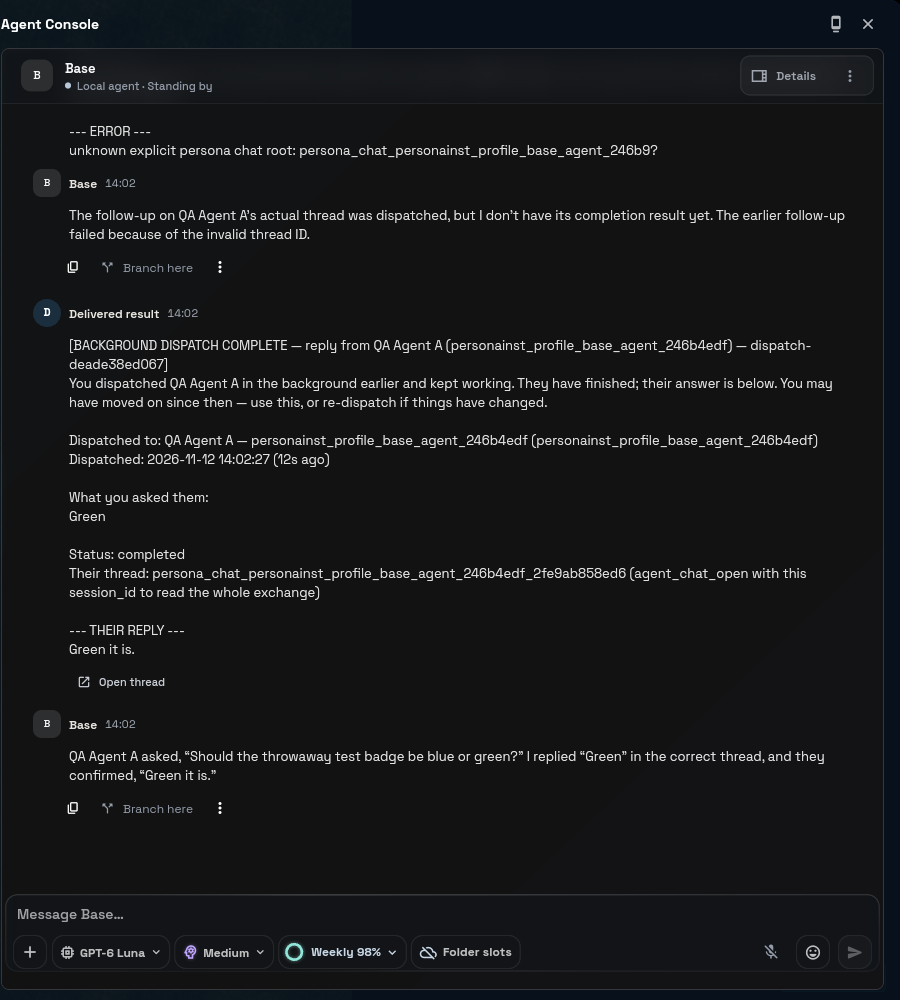

# RT-LEAN-OPERATIVE-RULES — R4 A/B clarify re-read, 2026-11-12 (lane w1112b-lean)

Owner ruling 2026-11-12: "Yes, one turn" — one real-model sitting on the QA provider account's plan limits.

## Setup

- Linux box, own Xvfb display, QA copy of Eternia (origin/main 72f151b656) through `launcher_qa`
  (`drive.dart`), `launch_or_attach {"profile": "stagec-smoke", "hermes_checkout": <this lane's hermes worktree>}`,
  NO `model_fixture`. Hermes served from this repository at 010bd05040.
- The lane namespace `stagec-smoke-lane-0a7f05dfd9` signs in through the QA provider pool
  (`HERMES_QA_PROVIDER_POOL=stagec-smoke`, an account sign-in, no API key). Every turn ran
  `model=gpt-6-luna provider=openai-codex` (the namespace's profile default).
- `agent_runtime.mission_chat.lean_operative_rules: true` written to the lane namespace ROOT `config.yaml`
  before the launch that ran the sitting; `mission_chat_lean_operative_rules()` read `True` under the serve's
  environment.
- Seeded with `qa.runtime.workspace.seed` (Base, QA Agent A, QA Agent B in workspace QA Fixture).

## What was sent

ONE operator message to Base (14:01:31 local), asking it to use `agent_chat_send` to have QA Agent A call its
`clarify` tool (blue or green), and to answer that question with green. The message did not mention
`clarify_token`. Full transcripts of both threads: [transcripts.txt](transcripts.txt).

## What the model did

1. Base dispatched QA Agent A (auto-detached to a background dispatch).
2. QA Agent A called `clarify` (choices Blue / Green). The runtime minted ticket `clarify-2f87bf3e7f38`
   (store `persona_chat_clarify_tickets`). The dispatch row's `result_json.clarify_request` carries the full token:
   **fix 3516b3d9e2 works live** — the delivery block now has the question, the choices, the token and the
   "answer on it" line.
3. **The delivery block, as stored in Base's thread, shows the token cut short: `clarify_token: clarif...7f38`**
   and `passing clarify_token=clarif...7f38`. `agent.redact.redact_sensitive_text` turns exactly those two lines into
   that (seen in a direct call under the serve's environment: a `…_token: <value>` assignment of 18+ characters keeps
   6 + 4 characters). Whether the API request carried the masked or the full text was read from the stored copy and
   the outcome only, not traced in the request.
4. Base **did** pass `clarify_token` on its answer without being told to (stored tool args show it as
   `[redacted]`), together with a malformed `session_id` (`persona_chat_personainst_profile_base_agent_246b9?`).
   A token that resolves overrides any `session_id` (`chat_request._resolve_mission_chat_clarify_binding`); this
   one did not resolve — the send went to the malformed thread and failed `unknown explicit persona chat root`.
5. Base then re-sent "Green" twice by `session_id` (once still malformed, once correct). The correct one landed in
   QA Agent A's thread ("Green it is."). The ticket settled `state: answered`, **`bound_via: session_id`** — not
   `clarify_token`.

## Verdict

- With the flag on, the threading and token rules DID reach the asker: it answered in the teammate's thread and
  reached for `clarify_token` on its own (as Neko did on 2026-10-25). Nothing here argues for moving the bullets into
  `harness-mission-lead`.
- The answer did NOT go back on its token, because the token the asker had was not the real one (masked by the
  secret redactor — seen in the stored delivery and in a direct redactor call; that the model saw the masked form is
  the reading of the outcome). Filed as `RT-DISPATCH-DELIVERY-CLARIFY-TOKEN-MASKED`.

## Cost

One operator message. Agent turns it caused: Base 5 (1 operator + 4 dispatch deliveries), QA Agent A 2 (two of the
four dispatches errored before any model call). API calls: Base 9, QA Agent A 3 — 12 in all, every one on
`gpt-6-luna` through the pool's account sign-in. No retries, no second operator message.
